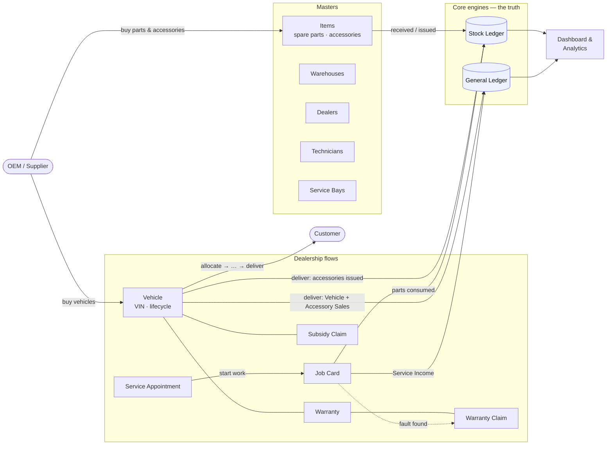
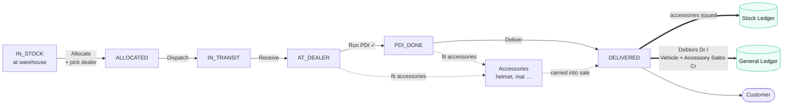
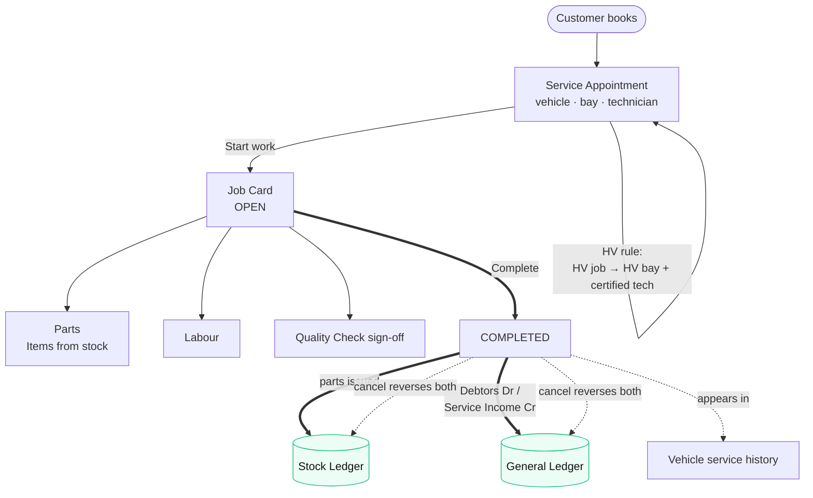
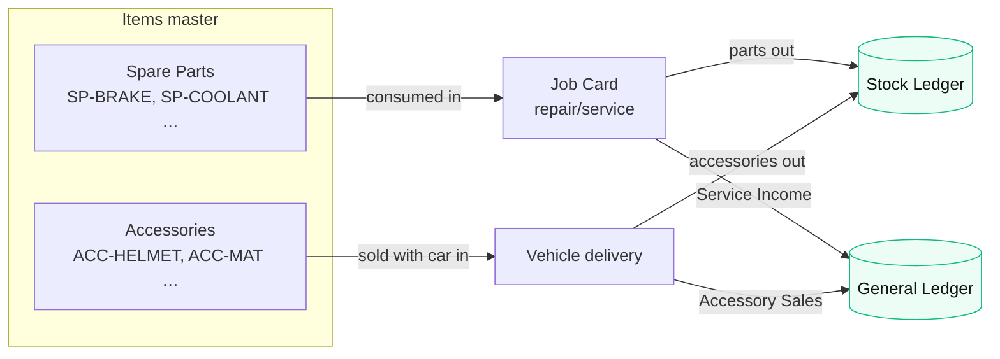
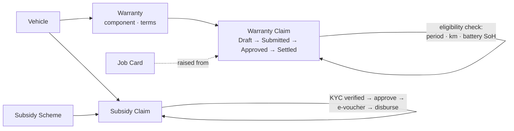

# Seeka Motor — How the modules connect

A visual guide to how the platform fits together. Two ideas explain almost
everything:

- **Stock Ledger** — the single source of truth for *quantity on hand*. Anything
  that moves inventory writes here.
- **General Ledger (GL)** — the single source of truth for *money*. Anything
  with a financial value writes here.

Every module is just a document that, at the right moment, posts to one or both
of these ledgers. That's the whole system.

---

## 1. The big picture

**Read it as:** the OEM supplies **vehicles** and **items**; those flow through
the dealership documents; and whenever stock or money actually moves, it lands in
the **Stock Ledger** / **General Ledger**, which the **Dashboard** then
summarises.

---

## 2. The vehicle sale — lifecycle

A vehicle is a **serialized unit** (one VIN). It moves through fixed stages;
only **delivery** touches money and stock.

**Key points**

- Allocate → Dispatch → Receive → PDI are **logistics only** — no money, no stock.
- **Accessories** can be fitted any time before delivery (recorded on the car).
- **Deliver** is the sale: accessories leave stock, and the vehicle + accessory
  revenue post to the GL — once.

---

## 3. Service & workshop — after the sale

The same car comes back many times for service. This is where **Items (spare
parts)** meet the vehicle.

**Key points**

- A **Service Appointment** is the booking; **Start work** turns it into a **Job
  Card**.
- Completing the job **issues the parts** (stock down) and **bills the customer**
  (Service Income). Cancel reverses both.

---

## 4. The Items seam — why parts & accessories matter

`Item` is one shared concept used two different ways by the dealership. (Note:
vehicles are **not** built from a BOM — they're bought-in finished units.)

---

## 5. Warranties, claims & subsidies (tracked alongside)

These don't move core stock; they track OEM reimbursements and government EV
incentives against the vehicle.

---

## In one sentence

> **Masters** (items, dealers, technicians…) feed **dealership documents**
> (vehicles, job cards, appointments…), and every time stock or money actually
> moves, it's recorded in the **Stock Ledger** and **General Ledger** — which the
> **Dashboard** rolls up.
