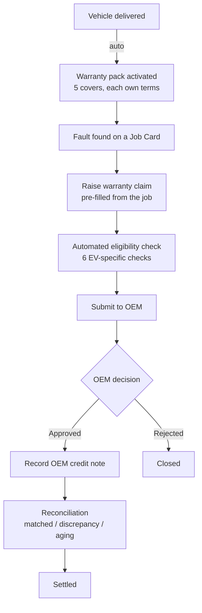
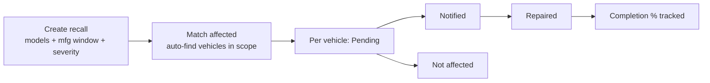

# DMS · Warranty Management

_Seeka Motor — Aftersales: warranties, claims, reimbursement & recalls_

> Status: **BUILT & live.** This covers the full warranty lifecycle — from
> coverage activated at the point of sale, through the claim-to-reimbursement
> workflow, to fleet analytics and OEM recall campaigns. Written so anyone
> (not just developers) can follow how it works.

---

## 1. The big picture

A warranty answers one question: **"is this repair the OEM's cost, or ours?"**
The module takes a car from the moment it's sold, through any fault that comes up,
to the OEM paying us back — and separately runs **recall campaigns** when the OEM
flags a batch of cars as needing a fix.



Everything is reachable from **Dealership → Aftersales** in the sidebar
(Warranties · Claims · Recalls), plus a per-vehicle warranty page and a few
tool pages reached by buttons (to keep the sidebar short).

---

## 2. Flow 1 — Warranty Registration at Sale

**What happens:** the moment a vehicle is **delivered** (its lifecycle reaches
`DELIVERED`), the standard OEM warranty pack is **activated automatically** — no
one has to key it in. Each component carries its **own independent terms**:

| Cover | Period | Mileage cap | Special |
|---|---|---|---|
| Bumper-to-bumper (Vehicle) | 36 months | 100,000 km | covers all systems |
| Powertrain | 60 months | 160,000 km | |
| Battery | 96 months | 160,000 km | **covered only if SoH drops below 70%** |
| Motor | 60 months | 160,000 km | |
| Corrosion / anti-perforation | 72 months | — | |

- **Where:** open any **Vehicle → "Warranty"** button → the per-vehicle
  **registration page** (`/dms/warranties/vehicle/<id>`). It shows the customer +
  vehicle, a **coverage card per component with a start→expiry timeline bar**,
  headline numbers, and recent claims.
- **Older vehicles** (delivered before this existed) show "No coverage yet" with a
  **"Register coverage"** button that activates the same pack manually.
- The **Warranties** list page leads with analytics: active covers, expiring ≤ 90
  days, vehicles covered, auto-registered count, coverage-by-component chart, and
  an "expiring soon" list.

---

## 3. Flow 2 — Raising a claim (documentation, pre-filled from the job)

When a technician finds a fault during service, they raise the claim **straight
from the Job Card**:

1. On a **Job Card**, click **"Warranty claim"**.
2. The new claim form **pre-fills** from the job: diagnosis (from the complaint),
   parts needed, cost, photos, and a **suggested active warranty** (battery first).
3. The user adds the **fault code**, **labor code**, evidence links and documents
   to submit, then saves a **DRAFT**.

A claim captures the full documentation set: fault code · labor code · diagnosis ·
parts needed · photo/video evidence · documents · claimed amount · expected
reimbursement date.

---

## 4. Flow 3 — Automated Eligibility Check (EV-specific)

Before a claim goes to the OEM, the system runs an **automated check** so you
don't submit something that'll bounce. Six checks:

| Check | What it verifies |
|---|---|
| **Warranty active** | not void |
| **Within period** | today is before the cover's expiry |
| **Within mileage** | odometer (from the job card) ≤ the km cap |
| **Battery SoH** | for battery cover: SoH **below** the threshold → **auto pre-qualified** |
| **Fault code** | the DTC matches the component's covered codes (advisory) |
| **Maintenance** | last service is within the OEM schedule (advisory) |

- The first four are **hard checks** — any fail makes the claim **not eligible**.
  Fault-code and maintenance are **advisory** (they warn, they don't block,
  because OEM taxonomies vary).
- **On the claim page** the full breakdown shows as a panel (result banner +
  every check + coverage + vehicle/job info).
- A standalone **"Check eligibility"** tool (button on the Claims page) lets you
  run the same check for any warranty + fault code + odometer **before** creating a
  claim.

---

## 5. Flow 4 — OEM Submission & Tracking

Every claim keeps a **tracking timeline** so you always know where it stands:

```
CREATED → SUBMITTED (with the eligibility verdict) → [OEM reviewer COMMENTs]
        → APPROVED / REJECTED → SETTLED → REIMBURSED
```

- **Submit to OEM** runs the eligibility report, stores the verdict + breakdown,
  and logs a timeline entry.
- You can log **OEM reviewer comments** and internal notes against the claim.
- The claim detail shows a **financial summary** (claimed → approved → reimbursed
  → outstanding, + expected date), a **documents & evidence** card, and the claim
  **breakdown** (codes, diagnosis, parts).
- Lifecycle guards: only **DRAFT** claims edit/delete; approve only from
  **SUBMITTED**; settle only from **APPROVED**.

---

## 6. Flow 5 — Reimbursement Reconciliation

This answers: **"did the OEM actually pay us the right amount, and when?"**

- You record each **OEM credit note** (number, amount, date) and **match** it to an
  approved/settled claim. Matching compares the note's amount to the claim's
  approved amount:
  - amounts equal → **MATCHED** (fully reconciled, outstanding → ₹0)
  - amounts differ → **DISCREPANCY** (flagged; the shortfall stays outstanding)
- The **Reconciliation page** (button on Claims) shows:
  - **summary** — approved / reimbursed / outstanding / discrepancies + unmatched notes
  - **payment aging** — outstanding bucketed by days since approval (0–30 / 31–60 / 61–90 / 90+)
  - **reimbursement trend** — credit-note value per month
  - **top outstanding claims** by amount, and **recent credit notes** with inline matching
- **Rule:** credit notes are the authoritative payment record. Once a claim has
  credit notes, the manual "Record reimbursement" shortcut is disabled so the two
  can't silently fight. Credit notes only attach to **approved/settled** claims.

---

## 7. Flow 6 — Warranty Analytics (EV-specific)

The **Analytics page** (button on Warranties) turns all the above into insight:

- **Headline:** total claims, **rejection rate** (+ approval rate), average claim
  value, and a **warranty cost forecast** (average of the last 3 months).
- **Claim frequency by model** and **by dealer**, **top fault codes**, warranty
  **cost by month**.
- **Battery health fleet report** — fleet SoH distribution, average SoH, count of
  **batteries at risk** (under battery warranty with SoH below threshold), and a
  **predicted warranty liability** (at-risk batteries × average battery claim).
  This is how you see a future cost coming before it hits.

---

## 8. Flow 7 — Recall Campaigns

Separate from claims: when the OEM issues a **recall**, you manage which cars are
affected and chase the fix.



- **Create** a campaign (code, title, affected component, **severity**, affected
  **models**, optional **manufacturing-date window**).
- **"Match affected"** auto-adds every vehicle whose model + mfg date fall in scope
  (idempotent — safe to re-run); you can also add vehicles by hand.
- Each affected vehicle is tracked **Pending → Notified → Repaired** (or
  **Not affected**), with a **completion bar** and analytics (open campaigns /
  affected / pending / repaired %).
- **Where:** Dealership → Aftersales → **Recalls** (`/dms/recalls`).

---

## 9. Data model (as built)

```
Warranty         vehicleId, component, startDate, months, kmLimit?, soHThreshold?,
                 status(ACTIVE|VOID), autoRegistered        // one per component
WarrantyClaim    name, warrantyId, jobCardId?, faultCode, laborCode, diagnosis,
                 partsNeeded, evidence[], documents[], claimAmount, approvedAmount,
                 reimbursedAmount, expectedReimburseAt, status, eligibility fields
ClaimEvent       claimId, kind(CREATED|SUBMITTED|COMMENT|APPROVED|REJECTED|
                 SETTLED|REIMBURSED|NOTE), note, by, at       // the timeline
CreditNote       number, amount, noteDate, claimId?, status(UNMATCHED|MATCHED|
                 DISCREPANCY)                                 // reconciliation
RecallCampaign   code, title, component?, severity, models[], mfgFrom?, mfgTo?,
                 status(OPEN|CLOSED)
RecallItem       campaignId, vehicleId, status(PENDING|NOTIFIED|REPAIRED|
                 NOT_AFFECTED), jobCardId?, notifiedAt?, repairedAt?
```

The eligibility maths (expiry, SoH threshold, fault-code map, maintenance cadence)
lives in one pure module, `lib/services/warranty-eligibility.ts`, so the claim
page, the pre-check tool, and submit all compute the same way.

---

## 10. Where to find everything (UI map)

| Page | Route | Reached from |
|---|---|---|
| Warranties list + analytics | `/dms/warranties` | sidebar · Aftersales |
| Per-vehicle registration | `/dms/warranties/vehicle/<id>` | Vehicle → "Warranty" |
| Warranty Analytics | `/dms/warranties/analytics` | Warranties → "Analytics" |
| Claims list | `/dms/warranty-claims` | sidebar · Aftersales |
| Eligibility check tool | `/dms/warranty-claims/check` | Claims → "Check eligibility" |
| Reconciliation | `/dms/warranty-claims/reconciliation` | Claims → "Reconciliation" |
| Raise claim (pre-filled) | `/dms/warranty-claims/new?job=<id>` | Job Card → "Warranty claim" |
| Recalls | `/dms/recalls` | sidebar · Aftersales |

---

## 11. Not in scope (yet)

- Real OEM portal API integration — submission/tracking is modelled internally.
- SoH **history over time** — eligibility uses the vehicle's current `batterySoH`
  (a single reading), not a trend. Battery analytics aggregate the current fleet.
- Notifications / emails to customers for recalls.
