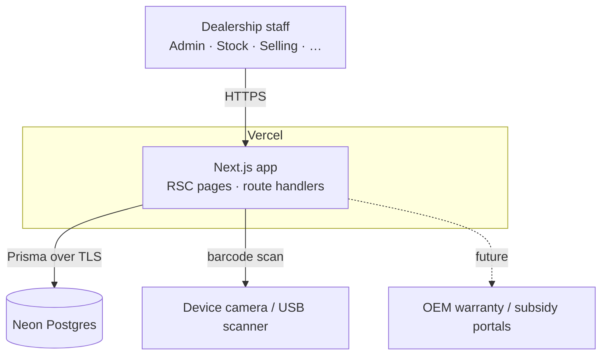
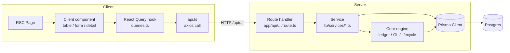
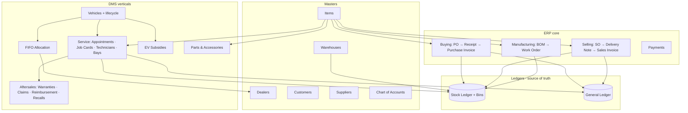
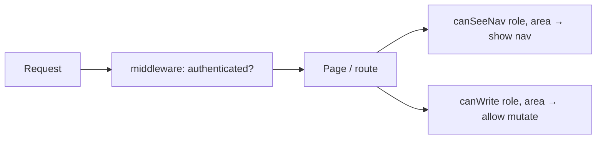
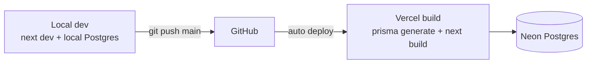

# Seeka Motor — High-Level Design (HLD)

_EV Dealer Management System — architecture overview for engineers._

> Read this first for the big picture, then [`lld.md`](./lld.md) for how to actually
> build in the codebase. Domain deep-dives live in [`architecture-flow.md`](./architecture-flow.md),
> [`stock-ledger.md`](./stock-ledger.md), [`barcode-batch-tracking.md`](./barcode-batch-tracking.md)
> and [`dms/`](./dms).

---

## 1. What it is

Seeka Motor is a **single-tenant, full-stack web application** that runs an EV
dealership end to end. It has two layers of functionality:

1. **ERP core** — items/stock, warehouses, buying, selling, accounting (stock
   ledger + general ledger), light manufacturing (BOM / work orders).
2. **DMS verticals** (the dealership) — vehicles & their lifecycle, dealers,
   FIFO allocation, service (appointments, job cards, technicians, bays),
   aftersales (warranties, claims, reimbursement, recalls), and EV subsidies.

Everything is one Next.js app backed by one Postgres database.

---

## 2. Tech stack

| Concern | Choice | Version |
|---|---|---|
| Framework | Next.js (App Router, RSC + route handlers) | 16.4.6 |
| Language | TypeScript | 5.x |
| UI | React | 19.3 |
| Styling | Tailwind CSS v4 + shadcn/radix-ui primitives | 4.3 / 1.8 |
| Data fetching (client) | TanStack Query + axios | 5.10 / 1.x |
| Forms | react-hook-form + Zod | 7.9 / 4.6 |
| URL state | nuqs | 2.10 |
| Charts | Recharts | 3.x |
| Barcodes | jsbarcode (render) + @zxing/library (camera scan) | 3.12 / 0.23 |
| ORM | Prisma + `@prisma/adapter-pg` (driver adapter) | 7.10 |
| Database | PostgreSQL (Neon in prod) | 16 |
| Tests | Vitest (against a real Postgres test DB) | 5.1 |
| Hosting | Vercel (app) + Neon (DB), deployed from GitHub `main` | — |

---

## 3. System context

Single app, single DB. No microservices, no message queue. External portals
(OEM warranty, government subsidy) are **modelled internally** today, not
integrated.

---

## 4. Architecture — the layered slice

Every feature is the same vertical slice. Data flows one way; each layer has a
single job.

- **Pages** (`app/(app)/…/page.tsx`) — thin RSC shells; pass IDs/params to a
  client component. Usually `export const dynamic = "force-dynamic"`.
- **Client components** (`features/*`, `modules/dms/*`) — tables, forms, detail
  views. Never touch the DB; they call hooks.
- **Hooks** (`queries.ts`) — TanStack Query `useQuery`/`useMutation`, cache keys,
  invalidation, toasts.
- **api.ts** — typed axios wrappers (the HTTP contract).
- **Route handlers** (`app/api/**/route.ts`) — parse + Zod-validate input, call a
  service, map errors (`errorResponse`). No business logic.
- **Services** (`lib/services/*.ts`) — all business logic + Prisma. The only
  layer that writes to the DB.
- **Core engines** (`lib/*.ts`) — shared transactional primitives used by many
  services (see §6).

**Rule:** business logic lives in services; UI never imports Prisma; the DB is
only touched inside services/engines, usually within a `prisma.$transaction`.

---

## 5. Domain map

The **Stock Ledger** and **General Ledger** are the system's sources of truth:
whenever stock or money actually moves, a service posts to them. Everything else
(dashboards, reports, analytics) reads from there.

---

## 6. Core cross-cutting engines

These `lib/*.ts` primitives are shared by many services and carry the real
invariants. Full behaviour in the LLD (§4) and `stock-ledger.md`.

| Engine | File | Responsibility |
|---|---|---|
| **Stock Ledger** | `lib/stock-ledger.ts` | Post a stock movement; maintain per-(item,warehouse) **Bin** with **moving-average** valuation. Returns the valuation delta. |
| **General Ledger** | `lib/gl.ts` | Double-entry postings (`postGL`), account lookup, `reverseGL` for cancellations. |
| **Vehicle lifecycle** | `lib/services/vehicle-lifecycle.ts` | State machine `IN_STOCK → ALLOCATED → IN_TRANSIT → AT_DEALER → PDI_DONE → DELIVERED (+IN_SERVICE)`; stage-guarded transitions + audit events; posts the sale + activates warranties at delivery. |
| **FIFO allocation** | `lib/services/allocation.ts` | Match oldest in-stock vehicles to dealer demand (priority, then first-come); preview then commit. |
| **Batch (FEFO)** | `lib/batch-stock.ts` | Lot tracking with expiry; first-expiry-first-out consumption. |
| **Serial stock** | `lib/serial-stock.ts` | Per-unit tracking; receive / consume-oldest / restore. |
| **Warranty eligibility** | `lib/services/warranty-eligibility.ts` | Pure EV-specific checks: period, mileage, battery SoH threshold, fault code, maintenance. |

---

## 7. Data model (overview)

**58 Prisma models / 23 enums**, grouped:

- **Stock**: Item, Batch, SerialNo, Warehouse, Bin, StockLedgerEntry, StockEntry(+Detail), StockReconciliation(+Item).
- **Manufacturing**: Bom(+Item, +ExplosionItem), WorkOrder(+Item).
- **Buying/Selling**: Supplier, Customer, PurchaseOrder/Receipt/Invoice, SalesOrder/DeliveryNote/Invoice (+ their items).
- **Accounting**: Account, GLEntry, PaymentEntry.
- **DMS**: Vehicle(+Accessory, +Specification, +Event, +Inspection, +InspItem), Dealer, AllocationRequest/Rule, JobCard(+Part, +Labor), Technician, ServiceBay, ServiceAppointment, Warranty, WarrantyClaim, ClaimEvent, CreditNote, RecallCampaign/Item, SubsidyScheme/Claim.
- **Platform**: User.

**Clean-boundary rule:** DMS entities reference core entities **by id** (loose
refs), not hard FKs across every boundary — keeps verticals decoupled. Money is
`Decimal`, quantities are `Decimal`/`Float`; always convert with `Number()` at
the service edge.

---

## 8. Auth & access control

- **Auth**: cookie session (JWT-ish), `getSession()` server-side; login via
  `POST /api/auth/login`.
- **Roles** (per user): `ADMIN · STOCK · BUYING · SELLING · ACCOUNTS · VIEWER`.
- **Areas** (feature domains): `stock · manufacturing · buying · selling ·
  accounts · dms`.
- Two matrices in `lib/permissions.ts`: **WRITE** (can mutate an area) and **NAV**
  (can see an area). `canWrite(role, area)` / `canSeeNav(role, area)` are pure and
  edge-safe. `ADMIN = all`, `VIEWER = read-only`.
- **Module gating**: `lib/modules.ts` toggles whole verticals (`erp`, `dms`); the
  sidebar hides groups the role can't see or whose module is off.

---

## 9. Deployment & environments

| Env | DB | Schema change |
|---|---|---|
| **Local** | `127.0.0.1:5432/nexterp` | `prisma db push` |
| **Test** | `…/nexterp_test` | `DATABASE_URL=… prisma db push` |
| **Prod** | Neon | idempotent SQL via a DNS-patched one-off script (see LLD §8) |

- No migration files — Prisma **`db push`** workflow. After any schema change:
  push dev + test, `prisma generate`, restart dev (stale client → 500s).
- Prod schema changes are applied with a small idempotent script (ADD COLUMN IF
  NOT EXISTS, enum guards), because Vercel build does not run migrations.

---

## 10. Design principles

1. **One vertical slice per feature** — predictable: page → hook → api → route →
   service → engine → db.
2. **Services own the truth** — all writes + invariants in `lib/services`, inside
   transactions; UI and routes stay thin.
3. **Ledgers are authoritative** — never store derived balances; post movements
   and read them back.
4. **Loose coupling across verticals** — reference core by id; a DMS vertical can
   evolve without breaking ERP.
5. **Minimal, consistent UI** — shared primitives (DataTable, Combobox,
   DetailHeader, StatCards, BarcodeLabelSheet); forms are RHF + Zod with the
   schema shared client/server.
6. **Tested invariants** — the money/stock/lifecycle engines are covered by
   Vitest against a real Postgres (115+ tests).

---

## 11. Non-functional notes

- **Performance**: list endpoints are paginated (`ListParams`); dashboards
  aggregate server-side. `force-dynamic` on data pages (no stale caching of
  live stock/money).
- **Consistency**: multi-write operations run in `prisma.$transaction`; ledger
  posts are idempotent by voucher.
- **Observability**: errors normalised via `errorResponse`; dev server logs.
- **Security**: role gating on nav + write; input validated by Zod at the route.
