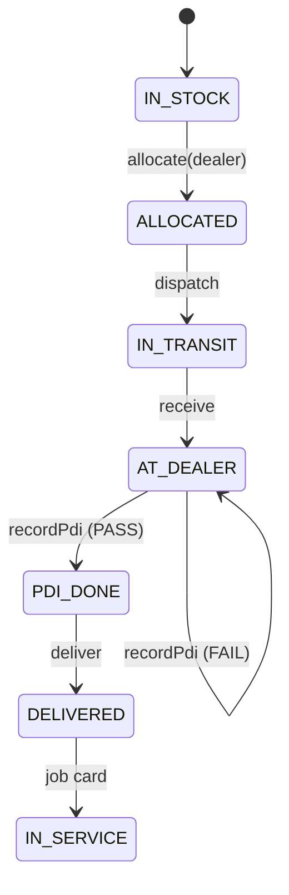
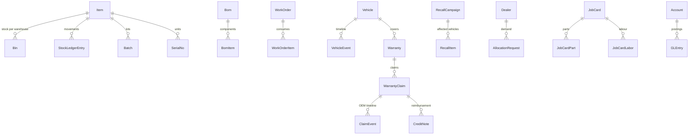

# Seeka Motor — Low-Level Design (LLD)

_How the codebase is organised and how to build in it. Read [`hld.md`](./hld.md) first._

---

## 1. Repository layout

```
app/
  (app)/                 # authenticated app (route group)
    stock/ buying/ selling/ accounts/ manufacturing/ dms/ settings/
    layout.tsx           # app shell (sidebar + header)
    page.tsx             # dashboard
  api/                   # route handlers (REST), one folder per resource
features/                # ERP feature modules (stock, buying, selling, accounts, mfg)
  <feature>/ schema.ts api.ts queries.ts columns.tsx *-table.tsx *-form.tsx *-detail.tsx
modules/dms/             # DMS vertical modules (same file pattern as features/)
lib/
  services/*.ts          # business logic + Prisma (the only DB writers)
  stock-ledger.ts gl.ts batch-stock.ts serial-stock.ts   # core engines
  api-list.ts api-server.ts axios.ts auth.ts session.ts permissions.ts modules.ts
  prisma.ts format.ts utils.ts storage.ts
components/
  ui/                    # shadcn/radix primitives (button, input, select, combobox, tabs…)
  data-table/ analytics/ detail/   # shared composites
  sidebar-nav.tsx app-shell.tsx new-button.tsx barcode*.tsx barcode-label-sheet.tsx
hooks/  prisma/schema.prisma  tests/  scripts/  docs/
```

- **`features/`** = ERP side, **`modules/dms/`** = dealership side. Same internal
  pattern (§2), so a dev learns one and knows both.
- **`lib/services/`** has one file per resource; **`app/api/`** mirrors it.

---

## 2. Anatomy of a module (the pattern)

A resource is a consistent set of files. Example (`modules/dms/recalls`):

```mermaid
flowchart TD
  schema[schema.ts<br/>zod form schema + TS types + enums/labels]
  api[api.ts<br/>axios wrappers typed by schema]
  queries[queries.ts<br/>React Query keys + hooks]
  cols[columns.tsx<br/>table column defs + badges]
  cell[cell-action.tsx<br/>row dropdown actions]
  table[*-table.tsx<br/>search + filters + DataTable + pagination]
  analytics[*-analytics.tsx<br/>StatCards + charts]
  form[*-form.tsx<br/>RHF + zodResolver]
  detail[*-detail.tsx<br/>DetailHeader + fields + actions]
  svc[lib/services/<name>.ts<br/>list/get/create/update/delete + actions]
  routes[app/api/<name>/route.ts + [id]/route.ts + action routes]

  schema --> api --> queries --> table & form & detail
  schema --> svc --> routes
  routes --> api
```

| File | Responsibility |
|---|---|
| `schema.ts` | Zod form schema (shared client **and** route), `empty…` default, TS read types (ListItem / Detail), enums + label maps. |
| `api.ts` | `fetchX`, `createX`, … — axios calls returning schema types. |
| `queries.ts` | `xKeys` cache keys, `useX`, `useCreateX` (mutations invalidate keys + toast). |
| `columns.tsx` | `ColumnDef<T>[]`, status/severity badges, links. |
| `cell-action.tsx` | Per-row dropdown (Open/Edit/Delete) gated by `useCanWrite`. |
| `*-table.tsx` | `useListParams` + search (debounced) + nuqs filters + `DataTable` + `DataTablePagination`. |
| `*-form.tsx` | `useForm({resolver: zodResolver(schema)})`, create/edit, `router.push` on success. |
| `*-detail.tsx` | `DetailHeader` + `Field`s + action buttons + confirm dialogs. |
| `*-analytics.tsx` | `StatCards` + `CategoryBarChart` from an analytics hook. |
| service | All logic + Prisma; returns the read types. |
| routes | Parse + `schema.parse()` + call service + `errorResponse`. |

---

## 3. Layer contracts

### Lists — `lib/api-list.ts`
```ts
type ListParams   = { page; limit; search; sort };       // server input
type ListResponse<T> = { rows: T[]; total; page; limit }; // server output
type ListQuery    = { page; limit; q; sort };             // client query
parseListParams(searchParams)  // URLSearchParams -> ListParams
parseSort(sort, SORTABLE, fallback)  // "field:asc" -> Prisma orderBy, whitelisted
```

### Service shape (canonical)
```ts
export async function listX(p: ListParams, filters: {...}): Promise<ListResponse<XListItem>>
export async function getX(id): Promise<XDetail | null>
export async function createX(values: XFormValues): Promise<{ id; name }>
export async function updateX(id, values): Promise<...>   // often status-guarded
export async function deleteX(id): Promise<void>          // guard FK refs, throw friendly msg
// + domain actions: submitX, approveX, allotX, finishX…
```

### Route shape (canonical)
```ts
export const dynamic = "force-dynamic";
export async function GET(req) {
  return NextResponse.json(await listX(parseListParams(req.nextUrl.searchParams), {...}));
}
export async function POST(req) {
  try { return NextResponse.json(await createX(xFormSchema.parse(await req.json())), {status:201}); }
  catch (e) { return errorResponse(e); }   // maps Zod/Error -> 4xx with {message}
}
```

### Client hook shape
```ts
export const xKeys = { all:["x"], lists:()=>[...], list:(p)=>[...], detail:(id)=>[...] };
export function useX(p){ return useQuery({ queryKey:xKeys.list(p), queryFn:()=>fetchX(p), placeholderData:keepPreviousData }); }
export function useCreateX(){ const qc=useQueryClient(); return useMutation({ mutationFn:createX,
  onSuccess:()=>{ qc.invalidateQueries({queryKey:xKeys.all}); toast.success("Created"); },
  onError:(e)=>toast.error(e.message) }); }
```

---

## 4. Core engines (LLD)

### 4a. Stock Ledger — `lib/stock-ledger.ts`
```ts
postStockLedger(tx, {
  itemId, warehouseId, actualQty,     // +receive / -issue
  incomingRate?, voucherType, voucherNo, postingAt, batchId?,
}) : { qtyAfterTransaction, valuationRate, stockValueDifference }
```
- Reads/creates the **Bin** (per item+warehouse), applies **moving-average**
  valuation: on receipt `newRate = (oldValue + qty*incomingRate)/(qtyAfter)`; on
  issue, value leaves at the current avg rate.
- Writes a `StockLedgerEntry` (immutable audit) and upserts the `Bin`
  (`actualQty`, `valuationRate`, `stockValue`).
- Returns `stockValueDifference` — services use it to post the matching GL amount
  (e.g. COGS). Always call inside the caller's `$transaction`.

### 4b. General Ledger — `lib/gl.ts`
```ts
postGL(tx, { lines:[{accountId, debit?, credit?}], voucherType, voucherNo, postingAt, againstParty? })
getAccountId(tx, "Debtors")   // resolve account by name (throws if missing)
reverseGL(tx, voucherType, voucherNo, postingAt)  // mirror entries to undo on cancel
```
Double-entry: debits must equal credits. Revenue flows post Debtors Dr / income
Cr; cancellations call `reverseGL`.

### 4c. Vehicle lifecycle — `lib/services/vehicle-lifecycle.ts`

- `requireStage(id, stage, action)` guards every transition (throws if the
  vehicle isn't at the expected stage).
- Each transition writes a **VehicleEvent** (audit timeline).
- `deliverVehicle` posts the **sale to the GL**, records customer, and
  **auto-activates the warranty pack** (see `dms/warranty-management.md`).
- Invariant (service `toData`): a vehicle with a dealer is ≥ `ALLOCATED`; a plain
  `IN_STOCK` vehicle has no dealer.

### 4d. FIFO allocation — `lib/services/allocation.ts`
`previewAllocation()` builds a plan (oldest matching in-stock vehicles → dealer
demand, by priority then age) without writing; `commitAllocation()` re-computes
fresh and calls `allocateVehicle` per match (so stale previews can't double-book).

### 4e. Batch (FEFO) & Serial — `lib/batch-stock.ts`, `lib/serial-stock.ts`
Batch = lot + expiry, consumed first-expiry-first-out. Serial = one unit,
consumed oldest-first; receive validates count == qty, rejects duplicates.

### 4f. Warranty eligibility — `lib/services/warranty-eligibility.ts`
Pure functions. `evaluateEligibilityReport()` returns a per-check breakdown
(active · period · mileage · battery-SoH · fault-code · maintenance); hard checks
drive the verdict, fault-code/maintenance are advisory. Reused by the claim page,
the pre-check tool and submit, so all compute identically.

---

## 5. Permissions & nav gating — `lib/permissions.ts`, `components/sidebar-nav.tsx`

- `WRITE: Record<Role, Area[]|"all">` and `NAV: Record<Role, Area[]|"all">`.
- Sidebar `NAV` groups each map to an `Area` (`HEADING_AREA`) and a module
  (`HEADING_MODULE`). `visibleNavGroups(role)` drops groups the role can't see,
  modules that are off, and area-gated items; empty groups disappear.
- Client gating: `useCanWrite(area)` hides mutate buttons. Server gating:
  `canWriteServer(area)` / `getSession()`.

---

## 6. Shared UI building blocks (`components/`)

| Component | Use |
|---|---|
| `data-table/DataTable` + `DataTablePagination` | All list tables (columns + meta sort). |
| `ui/combobox` `Combobox` | Searchable, scrollable single-select for long pickers (accepts `string[]` or `{value,label}[]`). |
| `detail/detail-shell` `DetailHeader`, `Field` | Consistent detail pages. |
| `analytics/stat-cards` `StatCards`, `analytics/category-bar-chart` | Analytics headers. |
| `barcode` `Barcode`, `barcode-label-sheet` `BarcodeLabelSheet` | Render / print barcode labels (with copies). |
| `barcode-scanner` `BarcodeCameraScanner` | Camera (ZXing) scan; needs HTTPS/localhost. |
| `new-button` `NewButton` | Permission-gated "create" action in page headers. |

**Forms**: `Form`/`FormField`/`FormItem` (shadcn) + `zodResolver`. `FormItem` uses
`grid content-start gap-2` so a field with helper text can't push its neighbour's
input out of alignment. Inputs/selects/outline-buttons use `bg-card` (pure white)
so they don't dissolve into the faintly-tinted page background.

---

## 7. Data model reference (key relations)



Conventions: `@db.Uuid` ids; `name` unique human codes (e.g. `WCLM-2026-00001`);
`Decimal(18,2)` money / `Decimal(18,6)` rates; `createdAt/updatedAt` everywhere;
cross-vertical refs by id.

---

## 8. How-to (recipes)

### Add a field to an existing resource
1. Edit `prisma/schema.prisma` (add the column).
2. `npx prisma db push` (dev) + `DATABASE_URL=…nexterp_test npx prisma db push` + `npx prisma generate`; restart `npm run dev`.
3. Add it to the module `schema.ts` (form schema + `empty…` + read type).
4. Service: include in `toData` (write) and the `to…Item`/`get…` mappers (read); add to search if useful.
5. Form field + detail display.
6. Prod: apply an idempotent `ALTER TABLE … ADD COLUMN IF NOT EXISTS` via the Neon script (below), then push code.

### Add a whole module
Copy an existing slice (e.g. `modules/dms/recalls`): create `schema/api/queries/
columns/cell-action/*-table/*-analytics/*-form/*-detail`, the service in
`lib/services`, the routes in `app/api/<name>`, pages under `app/(app)/…`, then a
`NAV` entry (+ `HEADING_AREA`/`HEADING_MODULE`) in `sidebar-nav.tsx`. Add Vitest
coverage + `resetDb` cleanup.

### DB workflow
- Dev/test: `prisma db push` (no migration files). `prisma generate` after schema
  changes; **restart dev** (stale Prisma client → 500s).
- Prod (Neon): one-off idempotent script that monkeypatches `dns.lookup` to the
  Neon IP and runs `ADD COLUMN IF NOT EXISTS` / enum-guarded SQL, then is deleted.
  (Vercel build does **not** migrate.)

### Testing — `tests/`
- Vitest against a **real** `nexterp_test` Postgres. `beforeEach(resetDb)` wipes
  in FK order; helpers: `makeVehicle`, `makeItem`, `makeWarehouse`, `seedAccounts`,
  `stockIn`, `glFor`. Run `npm test`.
- Test services directly (not HTTP). Cover invariants (ledger math, lifecycle
  guards, eligibility, reconciliation).

### Commits
`<type>: <summary>` (feat/fix/refactor/docs…). Keep slices coherent; run
`tsc --noEmit`, `eslint`, `npm run build`, `npm test` before pushing to `main`
(which auto-deploys to Vercel).

---

## 9. Gotchas & rules

- **Services only** write to the DB; wrap multi-writes in `prisma.$transaction`.
- **Ledgers are truth** — never persist a derived balance; post + read back.
- **Decimals**: Prisma returns `Decimal`; `Number(x)` at the service boundary;
  round money with a `round2` helper.
- **`force-dynamic`** on data pages/routes (live stock/money must not be cached).
- **Clean boundary**: reference core entities by id across verticals; don't add
  hard FKs that couple a DMS vertical to ERP internals.
- **RHF + Zod defaults**: a Zod `.default()` makes the field optional in the input
  type and can fight react-hook-form generics — prefer a separate server-side
  schema (e.g. `bookingApiSchema`) over defaults on the form schema.
- **Deleting masters**: guard FK refs (job cards, warranties, recalls, stock) and
  throw a friendly "reassign/remove first" message instead of a raw FK error.
